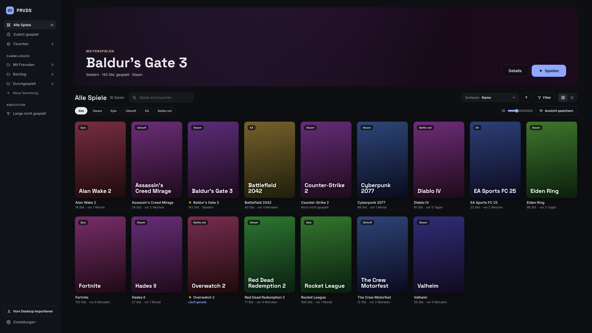
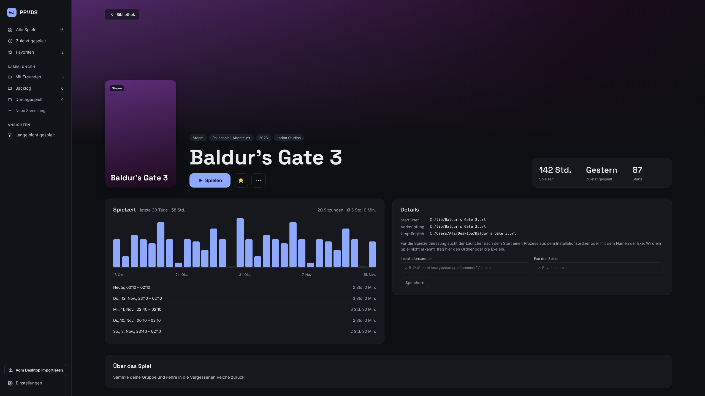

# PRVDS Game Launcher

Ein Game Launcher für Windows 10/11, gebaut mit Rust und Tauri v2. Er räumt den Desktop auf: Spiele-Verknüpfungen
wandern in die App (mit Rückgängig-Funktion), und alle Spiele liegen in einem „Game Space“ mit großen Covern,
Filtern, eigenen Ansichten und Spielzeitmessung.



> [!WARNING]
> **Spaßprojekt, mit KI gebaut.** Dieser Launcher ist ein privates Hobbyprojekt. Große Teile des Codes wurden
> mit einer KI (Claude von Anthropic) geschrieben und von Menschen geprüft und getestet, aber nicht wie ein
> kommerzielles Produkt. Es gibt **keine Garantie und keinen Support**. Die Nutzung erfolgt **auf eigene „Gefahr“**.
> Die App verschiebt Dateien auf deinem Desktop. Dabei achtet sie auf Sicherheit (Kopie prüfen, Journal,
> Rückgängig), trotzdem gilt: Wer wichtige Verknüpfungen hat, legt vorher eine Sicherung an.
> Siehe auch die [Lizenz](LICENSE).

## Was die App kann

- **Desktop aufräumen:** liest die Verknüpfungen (`.lnk`, `.url`) vom eigenen und vom öffentlichen Desktop und
  erkennt Spiele von Steam, Epic, Ubisoft Connect, EA App, Battle.net und Riot. Ausgewählte Verknüpfungen werden in
  den App-Ordner verschoben. Jeder Schritt lässt sich rückgängig machen, auch an die alte Position auf dem Desktop.
- **Launcher einlesen:** findet alle installierten Spiele in Steam, Epic, Ubisoft Connect, EA App, Battle.net
  und Riot, ganz ohne Desktop-Verknüpfung. Beim Start prüft die App, was neu dazugekommen oder deinstalliert ist.
  Deinstallierte Spiele bleiben mit ihrer Spielzeit in der Bibliothek.
- **Game Space:** Cover-Grid oder Liste, Suche, Sortierung (Name, zuletzt gespielt, Spielzeit, hinzugefügt …),
  Filter nach Plattform, Tags und Favoriten.
- **Boards:** eigene Ansichten zum Selbst-Anordnen. Ein Board hat Felder mit Titel, darin legst du Spiele per
  Drag & Drop auf Plätze, Lücken inklusive. Ein Spiel darf in mehreren Feldern und Boards stehen.
  Ein Board lässt sich über das Haus-Symbol in der Seitenleiste als Startseite festlegen. Felder können auch
  eine Sammlung zeigen, und jedes Board kann einen Hintergrund haben: eingebaute (teils animierte) Szenen oder ein
  eigenes Bild oder Video.
- **Eigene Ansichten:** Sammlungen per Drag & Drop und gespeicherte Ansichten (Filter, Sortierung, Layout).
- **Cover und Infos:** automatisch über Steam, optional SteamGridDB und IGDB. Eigene Bilder gehen per Drag & Drop.
- **Spielzeit:** erkennt, wann ein Spiel läuft, auch wenn es über Steam, eine Verknüpfung oder schon vor der App gestartet wurde, und zeigt Sitzungen und Verlauf.
- **Updates:** sucht auf Wunsch beim Start nach neuen Versionen (Kanäle „Stabil“ und „Dev“). Die Updates sind signiert.

| Spiel-Detail | Import-Assistent |
|---|---|
|  |  |

## Installation

1. Den neuesten Installer `PRVDS-Game-Launcher_<Version>_x64-setup.exe` unter
   [Releases](https://github.com/Provadis/PRVDS-Game-Launcher/releases) herunterladen.
2. Installieren. Admin-Rechte sind nicht nötig, die App wird nur für den eigenen Windows-Benutzer installiert.
3. Beim ersten Start „Desktop einlesen“ wählen, die Spiele auswählen und importieren.

Wer neue Funktionen früher haben möchte, findet den neuesten Entwicklungsstand unter dem Release
`dev-latest` oder stellt in den Einstellungen den Update-Kanal auf „Dev“. Dev-Builds können Fehler enthalten.

## Daten und Privatsphäre

- Alle Daten bleiben lokal unter `%APPDATA%\PRVDS\GameLauncher`: Datenbank, verschobene Verknüpfungen,
  Import-Journal und Cover.
- Die Launcher werden nur gelesen (Installationsdaten, Registry). Die App ändert dort nichts und meldet sich nirgends an.
- API-Keys für SteamGridDB und IGDB landen in der Windows-Anmeldeinformationsverwaltung, nie in Dateien.
- Die App ruft nur diese Dienste auf: Steam (Cover und Infos), SteamGridDB und IGDB (nur mit eigenem Key)
  sowie GitHub Releases (Update-Prüfung, lässt sich abschalten). Es gibt keine Telemetrie.
- Auf dem öffentlichen Desktop (`C:\Users\Public\Desktop`) darf Windows ohne Admin-Rechte nichts löschen.
  Verknüpfungen von dort werden deshalb kopiert, und das Original bleibt liegen.

## Aufbau

| Ordner | Inhalt |
|---|---|
| `crates/launcher-core` | Kernlogik ohne GUI: Desktop-Scan, sicheres Verschieben, SQLite-Bibliothek, Filter und Sortierung, Cover und Metadaten, Spielzeit |
| `src-tauri` | Tauri-App: Commands, App-Zustand, Prozessüberwachung, Updates |
| `src` | Oberfläche (SvelteKit, Svelte 5, TypeScript) |
| `docs` | Plan und Screenshots |

## Entwicklung

Voraussetzungen: Rust (stable), Node.js 22, unter Windows WebView2 (ist bei Windows 10/11 dabei).

```bash
npm install
npm run tauri dev      # App im Entwicklungsmodus
cargo test -p launcher-core
npm run check          # Typprüfung der Oberfläche
npm run tauri build    # Installer unter target/release/bundle
```

Lokale Builds haben keinen Update-Schlüssel, deshalb ist die Update-Funktion dort ausgeschaltet.

## Branches und Beiträge

Git Flow: Entwickelt wird auf `dev`, Releases gehen über `main`. Beide Branches sind geschützt und nehmen
Änderungen nur per Pull Request mit grüner CI an. Issues und Pull Requests sind willkommen. Da es ein
Hobbyprojekt ist, kann eine Antwort aber dauern.

## Versionen und Builds

Die Version steht nur in `package.json`. `node scripts/version.mjs set 0.4.0` überträgt sie in `Cargo.toml`,
und die CI prüft, dass beide übereinstimmen. Bis zur ersten stabilen Version zählen wir `0.x` hoch.

| Build | Auslöser | Datei | Veröffentlicht als |
| --- | --- | --- | --- |
| Dev | jeder Push auf `dev` | `PRVDS-Game-Launcher_0.3.0-dev.<Build-Nr.>_x64-setup.exe` | Pre-Release `dev-latest` (Kanal „Dev“) |
| Release | Tag `v0.3.0` auf `main` | `PRVDS-Game-Launcher_0.3.0_x64-setup.exe` und `.msi` | Release `v0.3.0` (Kanal „Stabil“) |

Der Installer-Workflow signiert die Update-Pakete. Dafür braucht das Repository das Secret
`TAURI_SIGNING_PRIVATE_KEY` (plus `TAURI_SIGNING_PRIVATE_KEY_PASSWORD`) und die Variable `TAURI_UPDATER_PUBKEY`.
Ohne sie entstehen weiterhin Installer als Artefakt, aber kein Release.

## Lizenz

[MIT](LICENSE). Die Test-Verknüpfungen unter `crates/launcher-core/tests/fixtures` stammen aus
[lnk-rs](https://github.com/lilopkins/lnk-rs) (MIT).
