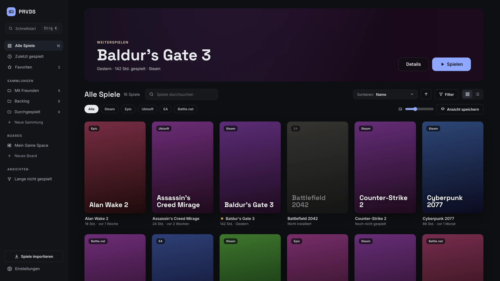
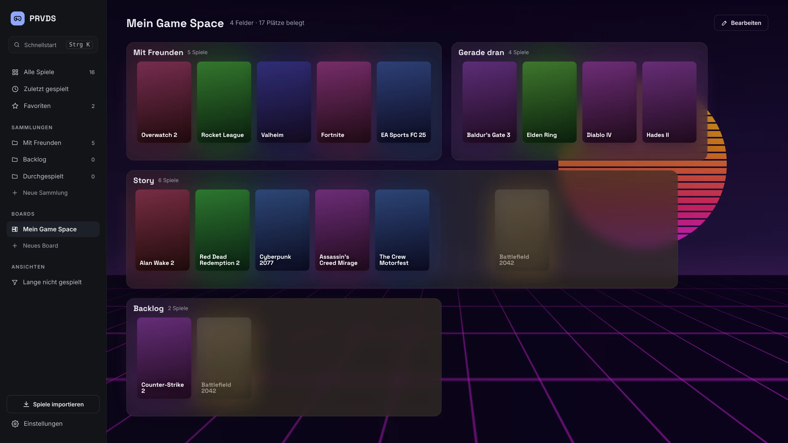
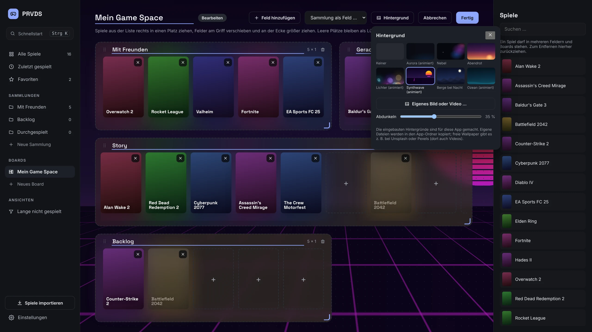
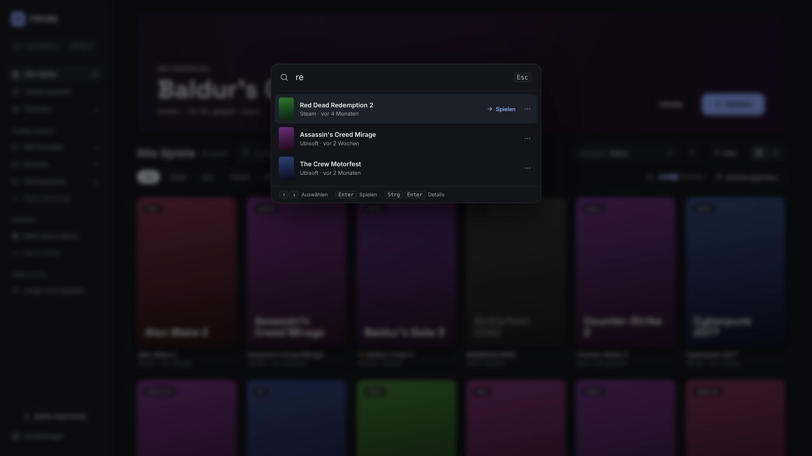
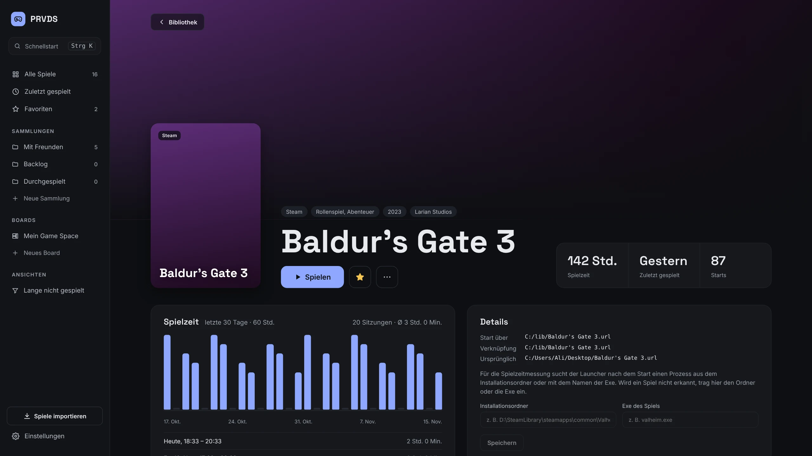
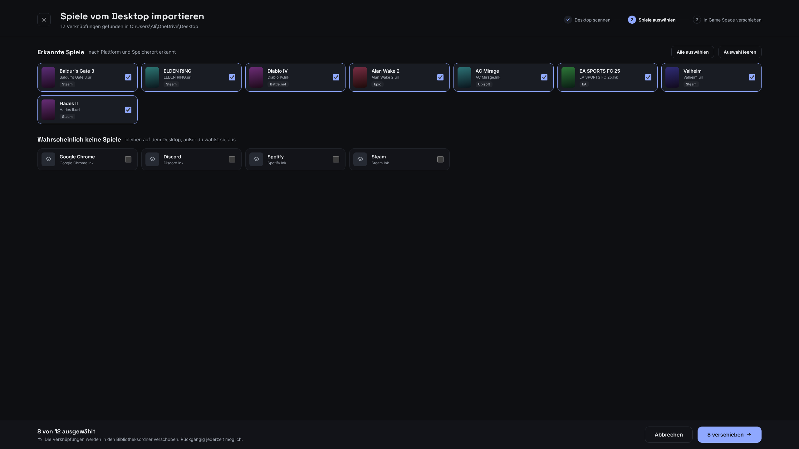

<div align="center">

# 🎮 PRVDS Game Launcher

**Alle deine Spiele an einem Ort. Und ein aufgeräumter Desktop.**

Ein schneller, schlanker Game Launcher für Windows 10/11, gebaut mit Rust und Tauri.
Er holt Spiele aus Steam, Epic, Ubisoft Connect, EA App, Battle.net und Riot in einen gemeinsamen „Game Space“,
räumt die Verknüpfungen vom Desktop und misst nebenbei deine Spielzeit.

[](https://github.com/Provadis/PRVDS-Game-Launcher/actions/workflows/ci.yml)
[](https://github.com/Provadis/PRVDS-Game-Launcher/actions/workflows/release.yml)
[](package.json)
[](https://github.com/Provadis/PRVDS-Game-Launcher/releases/tag/dev-latest)
[](LICENSE)
[](https://github.com/Provadis/PRVDS-Game-Launcher/commits/dev)


[Funktionen](#-funktionen) · [Screenshots](#-screenshots) · [Installation](#-installation) ·
[Tastenkürzel](#%EF%B8%8F-tastenkürzel) · [Cover](#%EF%B8%8F-cover-und-infos) · [Privatsphäre](#-daten-und-privatsphäre) ·
[Entwicklung](#%EF%B8%8F-entwicklung)

<br>



</div>

> [!WARNING]
> **Spaßprojekt, mit KI gebaut.** Dieser Launcher ist ein privates Hobbyprojekt. Große Teile des Codes wurden
> mit einer KI (Claude von Anthropic) geschrieben und von Menschen geprüft und getestet, aber nicht wie ein
> kommerzielles Produkt. Es gibt **keine Garantie und keinen Support**. Die Nutzung erfolgt **auf eigene „Gefahr“**.
> Die App verschiebt Dateien auf deinem Desktop. Dabei achtet sie auf Sicherheit (Kopie prüfen, Journal,
> Rückgängig), trotzdem gilt: Wer wichtige Verknüpfungen hat, legt vorher eine Sicherung an.
> Siehe auch die [Lizenz](LICENSE).

## ✨ Funktionen

| | |
|---|---|
| 🧹 **Desktop aufräumen** | Liest die Verknüpfungen (`.lnk`, `.url`) vom eigenen und vom öffentlichen Desktop, erkennt die Spiele darunter und verschiebt sie in den App-Ordner. Jeder Schritt lässt sich rückgängig machen, auch an die alte Position auf dem Desktop. |
| 🔌 **Launcher einlesen** | Findet alle installierten Spiele in Steam, Epic, Ubisoft Connect, EA App, Battle.net und Riot, ganz ohne Desktop-Verknüpfung. Beim Start prüft die App, was neu dazugekommen oder deinstalliert ist. Deinstallierte Spiele bleiben mit ihrer Spielzeit erhalten. |
| 🗂️ **Game Space** | Cover-Grid oder Liste, Suche, Sortierung (Name, zuletzt gespielt, Spielzeit, hinzugefügt …), Filter nach Plattform, Genre, Tags und Spielzeitraum. „Weiterspielen“ zeigt oben das zuletzt gespielte Spiel. |
| 🧩 **Boards** | Eigene Startseiten zum Selbst-Anordnen: Felder mit Titel, Spiele per Drag & Drop auf Plätze, Lücken inklusive. Felder können eine Sammlung automatisch zeigen, sich farblich an ihre Cover anpassen und horizontal scrollen. Ein Board lässt sich als Startseite festlegen. |
| 🌌 **Hintergründe** | Jedes Board kann einen Hintergrund haben: eingebaute, teils animierte Szenen (Aurora, Synthwave, Ozean …) oder ein eigenes Bild oder Video, mit Ausrichtung und Abdunkeln. |
| ⚡ **Schnellstart** | <kbd>Strg</kbd> + <kbd>K</kbd> öffnet eine Suche wie Spotlight. Ein paar Buchstaben oder Kürzel wie `bg3` tippen, <kbd>Enter</kbd> drücken, Spiel läuft. |
| ⏱️ **Spielzeit** | Erkennt, wann ein Spiel läuft, auch wenn es über Steam, eine Verknüpfung oder schon vor der App gestartet wurde. Zeigt Sitzungen und einen 30-Tage-Verlauf. |
| 🖼️ **Cover und Infos** | Offizielle Store-Bilder von Steam und Epic, dazu optional IGDB und SteamGridDB. Eigene Bilder gehen per Klick oder Drag & Drop. |
| 📁 **Sammlungen und Ansichten** | Sammlungen per Drag & Drop, gespeicherte Ansichten mit Filter, Sortierung und Layout. |
| 🌍 **Deutsch und Englisch** | Umschaltbar in den Einstellungen. Beim ersten Start gilt die Windows-Sprache. |
| 🔄 **Updates** | Sucht auf Wunsch beim Start nach neuen Versionen, mit den Kanälen „Stabil“ und „Dev“. Alle Updates sind signiert. |

## 📸 Screenshots

<table>
  <tr>
    <td width="50%"><br><sub><b>Boards</b> mit animiertem Hintergrund</sub></td>
    <td width="50%"><br><sub><b>Board bearbeiten</b>: Felder ziehen, Spiele einsortieren, Hintergrund wählen</sub></td>
  </tr>
  <tr>
    <td width="50%"><br><sub><b>Schnellstart</b> mit <kbd>Strg</kbd> + <kbd>K</kbd></sub></td>
    <td width="50%"><br><sub><b>Spieldetails</b> mit Spielzeitverlauf</sub></td>
  </tr>
  <tr>
    <td colspan="2"><br><sub><b>Import-Assistent</b> für den Desktop</sub></td>
  </tr>
</table>

## 📦 Installation

1. Den neuesten Installer `PRVDS-Game-Launcher_<Version>_x64-setup.exe` unter
   [Releases](https://github.com/Provadis/PRVDS-Game-Launcher/releases) herunterladen.
2. Installieren. Admin-Rechte sind nicht nötig, die App wird nur für den eigenen Windows-Benutzer installiert.
3. Beim ersten Start „Desktop einlesen“ oder „Aus Launchern einlesen“ wählen, Spiele auswählen, fertig.

> [!TIP]
> Wer neue Funktionen früher haben möchte, nimmt den Pre-Release
> [`dev-latest`](https://github.com/Provadis/PRVDS-Game-Launcher/releases/tag/dev-latest) oder stellt in den
> Einstellungen den Update-Kanal auf „Dev“. Dev-Builds können Fehler enthalten.

### Unterstützte Launcher

| Launcher | Desktop-Import | Direkt einlesen | Start über | Offizielle Cover |
|---|:---:|:---:|---|---|
| Steam | ✅ | ✅ | Steam | Steam |
| Epic Games | ✅ | ✅ | Epic Launcher | Epic (aus dem installierten Launcher) |
| Ubisoft Connect | ✅ | ✅ | Ubisoft Connect | Steam, falls dort vorhanden, sonst IGDB |
| EA App | ✅ | ✅ | EA App | Steam, falls dort vorhanden, sonst IGDB |
| Battle.net | ✅ | ✅ | Battle.net | Steam, falls dort vorhanden, sonst IGDB |
| Riot Games | ✅ | ✅ | Riot Client | IGDB |
| Sonstige (`.exe`, `.lnk`, `.url`) | ✅ | – | direkt | IGDB, SteamGridDB |

## ⌨️ Tastenkürzel

| Kürzel | Aktion |
|---|---|
| <kbd>Strg</kbd> + <kbd>K</kbd> | Schnellstart öffnen oder schließen |
| <kbd>↑</kbd> <kbd>↓</kbd> | Im Schnellstart ein Spiel auswählen |
| <kbd>Enter</kbd> | Ausgewähltes Spiel starten |
| <kbd>Strg</kbd> + <kbd>Enter</kbd> | Details des ausgewählten Spiels öffnen |
| <kbd>Esc</kbd> | Schnellstart, Dialog oder Board-Bearbeitung schließen |

## 🖼️ Cover und Infos

Die App sucht in dieser Reihenfolge und nimmt den ersten Treffer:

1. **Steam:** offizielle Library-Bilder für Steam-Spiele und für Spiele anderer Launcher, die es auch auf Steam gibt.
2. **Epic:** offizielle Store-Bilder aus dem Katalog des installierten Epic Launchers.
3. **IGDB:** offizielle Box-Art samt Genre, Entwickler und Erscheinungsjahr, nur mit eigenem Key.
4. **SteamGridDB:** Community-Bilder als Rückfall, nur mit eigenem Key.

Eigene Bilder: In den Spieldetails auf das Cover klicken und „Eigenes Bild“ wählen, oder eine Bilddatei direkt
auf das Cover ziehen. Das Bild wird in den Datenordner kopiert und auf Cover-Größe gebracht.

<details>
<summary><b>IGDB-Key einrichten</b> (kostenlos, ca. 5 Minuten)</summary>

1. Auf [dev.twitch.tv/console](https://dev.twitch.tv/console) mit einem Twitch-Konto anmelden. Dafür muss die
   Zwei-Faktor-Anmeldung an sein.
2. „Register Your Application“ wählen. Der Name ist egal, als OAuth Redirect `http://localhost`, als Kategorie
   „Application Integration“ und als Client-Typ „Confidential“.
3. Client-ID kopieren und mit „New Secret“ ein Client-Secret erzeugen.
4. Beides im Launcher unter Einstellungen bei „Cover und Metadaten“ eintragen, speichern und
   „Alle Cover neu laden“ drücken.

</details>

## 🔒 Daten und Privatsphäre

- Alle Daten bleiben lokal unter `%APPDATA%\PRVDS\GameLauncher`: Datenbank, verschobene Verknüpfungen,
  Import-Journal, Cover und eigene Hintergründe.
- Die Launcher werden nur gelesen (Installationsdaten, Registry). Die App ändert dort nichts und meldet sich nirgends an.
- API-Keys für SteamGridDB und IGDB landen in der Windows-Anmeldeinformationsverwaltung, nie in Dateien.
- Die App ruft nur diese Dienste auf: Steam (Cover und Infos), SteamGridDB und IGDB (nur mit eigenem Key)
  sowie GitHub Releases (Update-Prüfung, lässt sich abschalten). Es gibt **keine Telemetrie**.
- Auf dem öffentlichen Desktop (`C:\Users\Public\Desktop`) darf Windows ohne Admin-Rechte nichts löschen.
  Verknüpfungen von dort werden deshalb kopiert, und das Original bleibt liegen.

## 🛠️ Entwicklung

Voraussetzungen: Rust (stable), Node.js 22, unter Windows WebView2 (ist bei Windows 10/11 dabei).

```bash
npm install
npm run tauri dev           # App im Entwicklungsmodus
cargo test -p launcher-core # Tests der Kernlogik
npm run check               # Typprüfung der Oberfläche
npm run tauri build         # Installer unter target/release/bundle
```

Lokale Builds haben keinen Update-Schlüssel, deshalb ist die Update-Funktion dort ausgeschaltet.

### Aufbau

| Ordner | Inhalt |
|---|---|
| `crates/launcher-core` | Kernlogik ohne GUI: Desktop-Scan, sicheres Verschieben, Launcher-Anbindung, SQLite-Bibliothek, Filter und Sortierung, Boards, Cover und Metadaten, Spielzeit |
| `src-tauri` | Tauri-App: Commands, App-Zustand, Prozessüberwachung, Updates |
| `src` | Oberfläche (SvelteKit, Svelte 5, TypeScript), Übersetzungen in `src/lib/i18n-en.ts` |
| `docs` | Plan und Screenshots |

### Branches und Beiträge

Git Flow: Entwickelt wird auf `dev`, Releases gehen über `main`. Beide Branches sind geschützt und nehmen
Änderungen nur per Pull Request mit grüner CI an. Issues und Pull Requests sind willkommen. Da es ein
Hobbyprojekt ist, kann eine Antwort aber dauern.

### Versionen und Builds

Die Version steht nur in `package.json`. `node scripts/version.mjs set 0.6.0` überträgt sie in `Cargo.toml`,
und die CI prüft, dass beide übereinstimmen. Bis zur ersten stabilen Version zählen wir `0.x` hoch.

| Build | Auslöser | Datei | Veröffentlicht als |
| --- | --- | --- | --- |
| Dev | jeder Push auf `dev` | `PRVDS-Game-Launcher_0.5.0-dev.<Build-Nr.>_x64-setup.exe` | Pre-Release `dev-latest` (Kanal „Dev“) |
| Release | Tag `v0.5.0` auf `main` | `PRVDS-Game-Launcher_0.5.0_x64-setup.exe` und `.msi` | Release `v0.5.0` (Kanal „Stabil“) |

Der Installer-Workflow signiert die Update-Pakete. Dafür braucht das Repository das Secret
`TAURI_SIGNING_PRIVATE_KEY` (plus `TAURI_SIGNING_PRIVATE_KEY_PASSWORD`) und die Variable `TAURI_UPDATER_PUBKEY`.
Ohne sie entstehen weiterhin Installer als Artefakt, aber kein Release.

## 📄 Lizenz

[MIT](LICENSE). Die Test-Verknüpfungen unter `crates/launcher-core/tests/fixtures` stammen aus
[lnk-rs](https://github.com/lilopkins/lnk-rs) (MIT).

<div align="center">
<sub>Gebaut mit 🦀 Rust, ⚡ Tauri und viel ☕.</sub>
</div>
